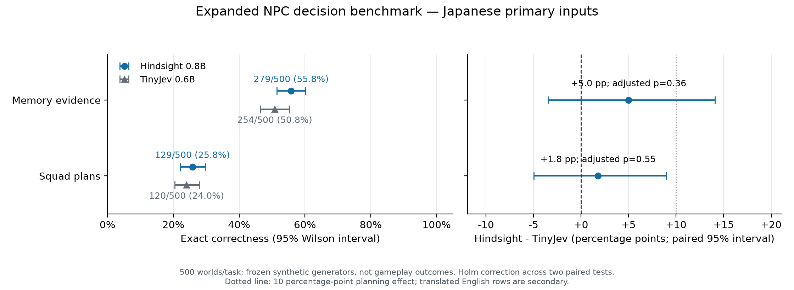

# Jev作戦選択の検証

Unity 6000.6.8f1で、TinyJevの学習済みbackboneと元のJev headをLLMUnityで実行する独立プロジェクト。SisterGame本体・有料アセットへの依存はない。Built-inを使用する。

Jevの担当は上位作戦の選択・切替。誘導から待ち伏せ・攻撃までの各段階は、選んだ作戦に対応する行動プリセットやMLモデル側が実行する。目的・個性は外部で保持して判断入力に含め、推論中も現在の行動を継続する運用を想定する。ゲーム本体への接続は未実装。

## 準備

このフォルダを作業ディレクトリにする。Pythonの依存は専用venvへ導入する。

```powershell
python -m venv Python/.venv
Python/.venv/Scripts/python.exe -m pip install -r Python/requirements.txt
Python/.venv/Scripts/python.exe Python/prepare.py real --output Python/Artifacts/tinyjev --device cuda
Python/.venv/Scripts/python.exe Python/prepare_gguf.py prepare --threads 4
Python/.venv/Scripts/python.exe Python/prepare_strategies.py --device cuda
```

CUDAを使わない場合は`--device cpu`。モデルは[AnkitAI/TinyJev-0.6B](https://huggingface.co/AnkitAI/TinyJev-0.6B)、revision `c559c2f7ea95069f92af8b999f512345bbb87d22`へ固定し、checkpointの6ファイルをハッシュ検証する。汎用Qwenの会話生成へ置き換えない。

`prepare.py real`は上流参照とONNX比較も生成する。ONNXをUnityのAssetsへコピーする必要はない。`Python/Artifacts/gguf/{F16,Q8_0,Q4_K_M}/`へGGUF・元FP32の`tinyjev.head`・ケースを生成し、この場所から直接選択する。モデル・venv・native bundleはGit対象外。

GGUFの再利用は`.gguf.provenance.json`と元checkpoint・変換tool・親F16・成果物のSHAを照合する。既存モデルを検証し直す場合は`Python/prepare_gguf.py verify-existing`を明示する。別ファイルへの再生成結果とSHAが完全一致した場合だけ検証情報を付ける。

UPMはLLMUnity 3.0.3のcommit `9931a9ea46906b1f43adaf9498c05ccf227b5d0b`、Pipeline `0.10.0-exp.1`、Sentis `2.6.1`へ固定。同梱LlamaLibは2.0.5、llama.cppは`872646b30c342c5fa98efec002f94fdb4f1f1ea5`。初回importで公式native bundle約1.82GBをディスクへ取得・展開する。

## Unityで実行

1. このフォルダをUnityで開き、`Tools > AI > Jev Validation`を開く。
2. `LLMUnityGPU`を選び、`Python/Artifacts/gguf/Q8_0/tinyjev-Q8_0.gguf`と同じフォルダの`cases-strategies.json`を選ぶ。
3. GPU offload層数は`99`で全層を要求する。使用率を%で指定する設定ではない。CPUは`LLMUnityCPU`を明示選択できる。
4. 各ケースの作戦ID・候補確率・参照との差・入力変更時の分布差を確認し、JSONを保存する。

`chosen_id`が選ばれた作戦ID。作戦IDと行動プリセットやMLパラメータの対応は、接続先の設定で管理する。

ヘッドレスでも動作する。GPUComputeのsmokeを実行する場合は`-nographics`を付けない。

```powershell
unity open "<このフォルダの絶対パス>" --batchmode --until-ready
unity command test run --mode editor --filter JevValidation.Editor.Tests --filter-type assembly --project-path "<このフォルダの絶対パス>" --format json
unity command script eval --code 'var r = await JevValidation.LlmUnityCaseRunner.RunAsync("Python/Artifacts/gguf/Q8_0/tinyjev-Q8_0.gguf", "Python/Artifacts/gguf/Q8_0/cases-strategies.json", default, JevValidation.LlmUnityBackend.GPU, 99); r.Save("Artifacts/strategy-Q8-GPU.json"); return new { r.backend, r.offloaded_gpu_layers, count = r.cases.Length };' --timeout 600 --project-path "<このフォルダの絶対パス>" --pid <専用EditorのPID> --format json
```

WindowsのGPU経路は公式cuBLAS backendを選び、actual offload層数とCUDA bufferを確認する。nativeログにはINFOを取得する`Debug(5)`／`--log-verbosity 3`を使う。サービスが生存中にcallbackを解除し、native終了までmanaged delegateを保持してから設定・排他を解放する。

## 作戦と比較ケース

作戦候補は次の8種類。個々の技や移動コマンドは生成しない。

| ID | 作戦 |
|---|---|
| direct_assault | 正面から攻勢を取る |
| lure_ambush | 囮・誘導・待ち伏せ・攻撃を一連のプリセットで行う |
| flank | 側面から有利な位置を取る |
| guard_ally | 味方を防護する |
| ranged_pressure | 遠距離から圧力をかける |
| observe | 状況を観察する |
| disengage | 離脱して立て直す |
| bypass | 交戦を回避して進む |

18ケースには、同じ戦況で性格3種類×目的2種類、同じ性格・目的で戦況だけを変えた3件、現在の作戦だけを変えた対照、候補順を変えた対照、作戦未設定の性格3種類×目的2種類を含める。目標の作戦を選ぶような指示は追加していない。

準備済みの自然文・token・候補順・参照値を保存し、候補本文もsnapshotとSHAで固定する。候補本文を変えた場合は参照を再生成して比較条件を揃える。`cases.json`の既存6ケース、元ONNX、3種類のGGUFとheadは作戦ケース生成時に変更しない。

上流PyTorch参照の作戦未設定時の結果:

| 性格 | 味方保護 | 脱出 |
|---|---|---|
| 狡猾 | lure_ambush 30.30% | lure_ambush 26.46% |
| 好戦的 | direct_assault 33.90% | disengage 28.18% |
| 慎重 | guard_ally 23.21% | disengage 37.19% |

性格・目的による選択差が出た。一方、現在の作戦をlure_ambushにした元9ケースはすべて同作戦を維持した。同じ戦況で現在の作戦だけをdirect_assault／observeへ変えると、それぞれが選ばれたため、現在作戦への依存が強い。候補順変更でも、ID整列後の最大確率差は約0.0382だった。

UnityのQ8 GPUでも8候補・512contextの全18ケースを実行し、上流と18/18で選択が一致した。平均1093.128ms／状態、最大確率差0.016404、全153組の状態比較を記録。上記の個性・目的による選択差も維持した。旧4ケースの速度比較とは入力長と候補数が異なるため分けて扱う。

これらは固定入力への反応を示す。作戦の新規評価と維持判定を分ける入力形式や、戦況急変時の切替は継続評価する。内部で先読み計画や永続記憶を持つこと、ゲーム内で目的を達成できることは、この比較からは判定しない。

## 代替モデルの比較

```powershell
Python/.venv/Scripts/python.exe Python/compare_strategies.py download
Python/.venv/Scripts/python.exe Python/compare_strategies.py run
```

同じ18ケースの自然文と保存済みの8候補本文を使い、NLIで候補を評価する。仮説文は比較前に固定し、望む結果になるよう調整していない。モデル・tokenizerのrevisionとLFS SHA／Git blobを固定・検証する。

| モデル | ONNX容量 | CPU平均ms／8候補 |
|---|---:|---:|
| [DeBERTa v3 xsmall zeroshot](https://huggingface.co/MoritzLaurer/deberta-v3-xsmall-zeroshot-v1.1-all-33) | 87.246MB | 510.116 |
| [NLI MiniLM2 L6](https://huggingface.co/cross-encoder/nli-MiniLM2-L6-H768) | 82.823MB | 496.688 |

CPU 4 threads、1ウォームアップ後、18ケースを各1回測定。load・tokenization・warmup・推論を分けて記録する。最大入力長は158／167tokenで上限512以内、切り詰めなし。Unityへは導入せずPythonのONNX Runtimeで比較した。

相対rankと、各候補のNLI class確率・raw logitsを別に保存する。相対rankはゲームの成功確率ではない。選択候補のentailment確率は約2〜7%で、現条件ではJevを置き換える根拠は得られていない。感情分析モデルへの固定はせず、作戦選択に対する適性を評価する。

結果は`Python/Artifacts/alternatives/`、元の参照は`Python/Artifacts/strategies/`へ保存する。

## GGUFと入力の契約

`schema_version=1`。モデルのrevision・SHA、head basename・SHA、量子化形式を持つ。モデルやheadがSHA不一致なら実行しない。

| 経路 | token_count | 候補数 |
|---|---:|---:|
| LLMUnity GGUF | 256または512 | 4〜8 |
| Sentis ONNX smoke | 256 | 4 |

各ケースの`choice_ids`と`option_positions`・参照確率の長さは同じ候補数とする。`input_ids`と`attention_mask`はtoken_count要素、decision位置は1件。位置は有効tokenを指し、参照値なしは誤差0として扱わない。候補IDを揃えて状態間の全変動距離(TV)を計算する。

LLMUnityは右paddingだけを除いた既存token IDsを、同一プロセスの`127.0.0.1`のraw `/embeddings`へ送る。BOS・chat template・L2正規化を追加せず、pooling none・因果マスク・最終RMSNorm後の全有効token行×1024要素を検証する。指定候補とdecision位置へ、元FP32 headの投影・temperature付き内積・softmaxを適用する。

headはASCII8バイト`JEVHEAD1`、Int32 little endianのhidden size=1024／head dimension=256、Float32のtemperatureとq_weight・q_bias・k_weight・k_bias。FP32 row-majorで2,099,220 bytes。

| GGUF | 容量MB（10⁶ bytes） | 既存CPU4ケースの上流参照との差・最大値 |
|---|---:|---:|
| F16 | 1198.18 | 0.001289 |
| Q8_0 | 639.44 | 0.005664 |
| Q4_K_M | 396.70 | 0.041503 |

元4ケースの選択は全形式で上流と一致した。Q4の確率差が大きいため、容量と選択品質を併せて評価する。各モデルを1つずつロードし、終了・破棄を待ってから次へ進む。

## 計測とテスト

測定環境はIntel Core i7-10750H @ 2.60GHz、RAM 31.8GiB、RTX 2070 SUPER 8GiB、Windows 11 Pro build 26200、Unity 6000.6.8f1のヘッドレスEditor。

`inference_ms`はHTTP要求から全token readback・JSON検証・head完了まで。`backbone_ms`はhead以外の区間、`head_ms`はhead計算。モデル起動時間と1ケースのwarmupを除く。受信IOはUnitySynchronizationContextへのchunkごとの復帰を避ける。旧IO処理を含んだ秒数はモデル本体の速度比較には使わない。

同じコード・Q8モデル・元4ケースで測定した結果:

| backend | 平均ms／ケース | 上流参照との選択一致 |
|---|---:|---:|
| CPU 4 threads | 1555.628 | 4/4 |
| GPU cuBLAS | 415.162 | 4/4 |

このGPU測定では29/29層のoffload、CUDA model buffer 604.15MiB、compute buffer 149.38MiBを確認した。GPUの参照確率との最大誤差は0.005119。旧IO処理と修正後CPUの出力確率は完全一致した。

VRAMの全体使用量はbaseline 1277MiBからpeak 2065MiBを観測した。desktop等の使用分を含む値で、WDDMのプロセス単独使用量は取得できなかった。上記CUDA buffer値とプロセス全体の使用量は分ける。

Python/から実行:

```powershell
.venv/Scripts/python.exe -m unittest -v test_prepare.py test_prepare_gguf.py test_prepare_strategies.py test_compare_strategies.py
```

Pythonは21/21、Unity EditModeは17/17成功、skipなし。head・GGUF境界・GPU証拠・可変候補を検証し、既存Sentis CPU/GPUCompute smokeも含む。実モデルは元4ケースの同コードCPU/GPU比較、個性だけを変えた2ケース、作戦18ケースを別に実行した。個性2ケースでは攻撃確率が約82.54%→73.31%、退避が約4.31%→8.83%へ変化し、最大候補は双方attackだった。0件実行は成功と数えない。

キャンセルは応答待機を止め、native処理の終了とモデル破棄・排他解放を待つ。CPU実モデルでは5秒後のキャンセル要求から約9秒で後処理完了を確認した。即時のnative停止は保証しない。

## Sentisの比較範囲と残件

Sentis CPU/GPUComputeは同梱`Assets/Models/smoke.onnx`と`Assets/PreparedCases/smoke.json`で確認できる。実TinyJevの一体型ONNXは、先行するWindows検証でUnity import時に約2.39GBの割当失敗があり、Assetsから外している。以下のLinux追試では4分割ONNXのimportと実モデルのSentis CPU推論を確認した。

Sentis 2.6.1の[量子化API](https://docs.unity3d.com/Packages/com.unity.ai.inference@2.6/manual/quantize-a-model.html)は読込後のモデルを変換する方式。一般的なONNX INT8の演算は[未対応一覧](https://docs.unity3d.com/Packages/com.unity.ai.inference@2.6/manual/supported-operators.html#unsupported-operators)を確認する。

ゲーム本体への作戦ID接続、維持・切替条件、同時個体数、幅広い戦況での判断品質、追加学習の要否は[将来タスク](../../docs/FUTURE_TASKS.md)で追跡する。

## 4分割ONNXとSentisのLinux追試（2026-11-06）

固定checkpointの6ファイルを既存のSHA一覧と照合し、元のFP16 backbone・FP32 pointer headを保った一体型ONNXを生成した。その計算グラフを、Embedding、Transformer 0〜9、10〜18、19〜27＋最終Norm・headへ分割する。分割時の追加学習・重み変更はない。共有する小さな定数の複製はFP32換算133,120 bytesで、Embeddingの重みは複製しない。

検証条件はUnity 6000.6.8f1、Sentis 2.6.1、Linux/Debian 13、AMD EPYC 9V74、CPU quota 4 cores、RAM上限16GiB。推論はSentis CPU、Job worker数4。実GPUはなく、graphics deviceはllvmpipe。元の256token・4候補の6ケースを使い、最初の1ケースを1回warmupした後に6ケースを各1回測定した。先行するWindowsの512context・8作戦18ケースとは条件が異なる。

| パーツ | ONNX容量（MB） | FP32換算initializer（MB） | 個別import（秒） |
|---|---:|---:|---:|
| Embedding | 311.17 | 622.33 | 5.82 |
| Transformer 0〜9 | 314.94 | 629.30 | 5.64 |
| Transformer 10〜18 | 283.45 | 566.38 | 4.42 |
| Transformer 19〜27＋Norm・head | 285.56 | 568.48 | 4.41 |

MB/GBは10進表記。最大パーツのFP32換算initializerは一体型2,386.37MBに対し629.30MBで73.63%小さい。この値はdtype・shapeから計算した重み量であり、Editor全体のRAM削減率を表さない。

| 実行 | 結果 | Editorの観測最大RSS |
|---|---|---:|
| 一体型ONNXのimport | import途中でSIGKILL、環境のOOM kill増加を確認 | 14.23GB |
| 新規Editorで4パーツを個別import | 4/4成功、import合計20.29秒 | 10.78GB |
| 別の新規Editorで既存import済みアセットを読み込み、CPU推論 | 6/6で上流参照と選択一致 | 8.36GB |

一体型は完了していないため、成功した両方式のロード時間・推論速度の比較はできない。RSSは100ms間隔のサンプル最大値で短いピークを取り逃す可能性がある。子プロセス込みRSS合計は共有ページの重複を含むため、16GiB上限との比較には使わない。cgroupの使用量には環境内の他プロセスとファイルキャッシュも含む。各測定は新規Editorで行い、importと、既存アセットの読み込み・推論を分けた。

CPU推論の確率最大絶対誤差は0.00005430、平均2,139.70ms／判断、warmupは2,040.63ms。元のPython参照と選択がすべて一致し、絶対誤差0.005以内を成功条件とする。入力Tensor作成、モデル読み込み、warmupは推論時間から除く。Python側でも分割ONNXの連鎖実行を確認し、6/6選択一致、最大絶対誤差0.0002618だった。

既存アセットの取得は合計1,538.86ms、`ModelLoader.Load`は894.05ms、Worker作成は41.88msで、合計2,474.80ms。Editor起動・warmup・SHA照合は含まない。モデル/入力のSHA照合と6ケースの推論等を含む検証呼び出し全体は45.68秒で、この2.47秒をツール全体の起動時間として扱わない。Sentis側の重み量子化、層ごとのロード/解放、GPUの実モデル性能、ゲームへの接続は今回の対象に含めていない。

最終ソースの検証コードはPython 26/26件、Unity EditMode 21/21件が成功し、失敗・skipは0。これらのテスト件数と、上記の実モデル6ケースの推論結果は分けて記録する。

### 再実行

`Python/requirements.txt`とCPU版または対象GPU版のPyTorchを専用venvへ導入する。外部RAM計測を使う場合は`psutil`も必要。以下は`Python/`を作業ディレクトリにする。`split-source`は`prepare.py real --output Artifacts/split-source --device cpu`で生成できる。既存モデルとケースを再利用する場合は、両者のSHA対応を保つ。

```bash
python prepare_split.py split --model Artifacts/split-source/tinyjev.onnx \
  --cases Artifacts/split-source/cases.json --output Artifacts/split-four
python prepare_split.py verify --manifest Artifacts/split-four/split-manifest.json --threads 4
python -m unittest -v test_prepare.py test_prepare_gguf.py test_prepare_strategies.py \
  test_compare_strategies.py test_prepare_split.py
```

分割先は新しいディレクトリを使う。既存manifest/ONNXを上書きしない。manifestには各ONNX・元ONNX・ケースJSONのSHAと実際の入出力名・shape・重みサイズを記録する。

Unityの専用Editorを維持した状態で、CLIの`script eval`から次を呼ぶ。headless LinuxではXvfbもEditor終了まで維持する。`unity open --batchmode --wait`をXvfb内で動かし、別ターミナルから専用projectを指定して操作できる。

```csharp
// 新規importだけを測る。パスは絶対パスで指定する。
await JevValidation.SplitSentisRunner.RunAsync(manifestPath, importReportPath, "import");
// Editorを再起動し、既存アセットのSHAを確認して再importせずに測る。
Unity.Jobs.LowLevel.Unsafe.JobsUtility.JobWorkerCount = 4;
await JevValidation.SplitSentisRunner.RunAsync(manifestPath, residentReportPath,
    "resident", reimport: false);
```

一体型を調べる場合は`SplitSentisRunner.ProbeMonolithic(sourceOnnx, reportPath)`を使う。この環境ではEditorのOOM終了を再現しているため、専用Editorで単独実行する。途中で終了した場合は同ツールが作成した`Assets/Models/MonolithicTinyJev`を退避してから再起動する。

`Python/measure_process.py --pid <Editor PID> --output <memory.json> -- <unity command ...>`で外部RSSを同時記録できる。CLIの終了コードに加え、結果JSONの`success`・`parity_passed`・実行件数も確認する。タイムアウト時はCLIだけが停止し、Editor内の処理が残る可能性があるため、そのEditorで次の測定を重ねない。

結果・条件・モデルSHA・ケース別の確率と時間は[Linux追試結果](Results/sentis-split-linux.json)に保存する。大容量モデルと生ログはGit対象外の`Python/Artifacts/`および当該クラウド環境の`/workspace/.cave-dungeon/unity/test-results/jev-split/`に保持する。

## Intern-Decisionとの比較（2026-11-06）

[Intern-Decision](https://github.com/InternLM/Intern-Decision)の公式0.8B・2B checkpointを、既存と同じ18ケース・8作戦で実行した。上流コードは`565350244af860e1c276768cd80bdd9b8be93913`へ固定し、checkpointは以下を使う。全weight shard・tokenizer・設定を、固定revisionのLFS SHA-256またはGit blob hashで検証した。

- `internlm/Intern-Decision-0.8B`：`42457fafd13d10d0b0d9be46cb30a23caa409994`
- `internlm/Intern-Decision-2B`：`85c5657708a09884ff9fd8d7f57789b410a97b33`

上流の`DecisionEngine`/`HFBackend`を直接使い、チェックポイント付属のtemplateと`<decision>`直前のlogits、合法なA〜Hのsingle-token softmaxを保持する。画像は使わず、温度補正はT=1。XTuner用の公開温度presetをHFへ流用せず、この18件で温度fitやcheckpoint選択をしない。

### Native CPU経路

同じクラウド環境、CPU4 threads・inter-op1、各モデルを別プロセスで順番に測定した。最初の1ケースを1回warmupした後、18件を各1回測る。時間はnative encode・モデル・復号を含む要求全体で、ファイルSHA照合・モデル初期化・warmupを除く。

| モデル | 経路・実dtype | 平均秒／判断 | 初期化秒 | プロセスの観測最大RSS |
|---|---|---:|---:|---:|
| TinyJev 0.6B | Torch 2.7.1 / FP32 | 2.493 | 4.645 | 3.95GB |
| Intern-Decision 0.8B | HF、Torch 2.9.1 / BF16 | 1.960 | 4.221 | 2.17GB |
| Intern-Decision 2B | HF、Torch 2.9.1 / BF16 | 3.728 | 4.314 | 4.43GB |

Intern側はTransformers 5.14.1・torchvision 0.24.1、TinyJev側は既存のTransformers 5.3.0・tinyjev 0.1.3。状態・質問・候補の順序は同じだが、各モデルの公式templateによって実入力はTinyJevが349〜359token、Internが498〜508tokenとなる。精度・実行方式・prompt長の異なる実装単位の測定であり、アーキテクチャだけの速度比較ではない。RSSにはモデル読み込み時の一時領域も含む。

TinyJevはAPIのtemperature引数1.0に加え、配布済みpointer head内の固定温度1.4640856959456252を保持する。この試験で温度をfitしたものではない。Internの合法token logitsに対するT=1とは処理が異なる。

「現在作戦なし」の6条件では次を選んだ。

| 性格 | 目的 | TinyJev | Intern 0.8B | Intern 2B |
|---|---|---|---|---|
| 狡猾 | 味方保護 | 誘導・待ち伏せ | 誘導・待ち伏せ | 誘導・待ち伏せ |
| 狡猾 | 生きて脱出 | 誘導・待ち伏せ | 誘導・待ち伏せ | 誘導・待ち伏せ |
| 好戦的 | 味方保護 | 正面攻勢 | 正面攻勢 | 味方護衛 |
| 好戦的 | 生きて脱出 | 離脱 | 正面攻勢 | 誘導・待ち伏せ |
| 慎重 | 味方保護 | 味方護衛 | 味方護衛 | 味方護衛 |
| 慎重 | 生きて脱出 | 離脱 | 味方護衛 | 誘導・待ち伏せ |

現在作戦を`lure_ambush`とした元9ケースは、3モデルとも9/9で維持した。現在作戦だけを`direct_assault`/`observe`へ変えた2対照では、TinyJevと0.8Bはそれぞれの現在作戦を選び、2Bはいずれも`lure_ambush`を選んだ。候補順を回した対照でも3モデルとも選択IDは維持したが、IDを揃えた最大確率差はそれぞれ0.03755 / 0.05548 / 0.08328だった。

この入力では0.8Bは性格による選択差を示した一方、同じ性格で目的だけを変えた3組では作戦を変えなかった。2Bではそのうち2組で変化した。正解作戦・ゲームの成功率は定義していないため、TinyJevとの一致16/18・13/18を精度と呼ばず、この結果だけで置き換えの優位性を判断しない。上流READMEのJev比較は別のhosted baselineで、このTinyJev 0.6B試験とは条件が異なる。

### Unity 0.8Bの準備と初回経路

LLMUnity 3.0.3 / LlamaLib 2.0.5に含まれるllama.cpp `872646b30c342c5fa98efec002f94fdb4f1f1ea5`はQwen3.5に対応している。0.8Bをtext-only F16 GGUFへ変換した容量は1,516,744,128 bytes。画像用のvision/projectorはこのGGUFへ含めない。

固定converterは現在のHF tokenizerのfingerprintを未登録として拒否したため、[上流commit e14a779](https://github.com/ggml-org/llama.cpp/blob/e14a779719652200cec7ad58dfa4820edc347182/conversion/base.py#L2116)にある当該hash→`qwen35`の認識だけを隔離した変換プロセスへ追加した。元のconverterファイル・チェックポイントは変更しない。元のtokenizer.jsonにはQwen3.5のregex/NFCがあるが、Transformers 5.14.1の`AutoTokenizer`は異なるregexを再構築するため、実際の設定差も来歴へ記録する。Unityへは公式HFで得た生token IDを渡し、native側の文字列tokenizerとの同値性は主張しない。

最初のUnity経路は、未加工の全token IDから生hiddenを取得し、元の合法A〜HのLM head 8行を適用する。18/18でHF参照と選択一致、最大確率差0.026868、モデル起動2.104秒、平均11.512秒／判断、Editor観測最大RSS4.25GBだった。絶対差0.02の数値診断は未達として保持する。判定IDの一致と確率差を別記録する。

この固定native実装のembedding modeは、pooling方法によらず全tokenを出力対象にし、Qwen3.5のLM headも全位置に対して計算する。公式HFの`logits_to_keep`は判断位置だけを計算するため、取得経路の違いがある。

### Unityで判断位置だけを取得する経路

`route: "completion"`では、同じHF由来のtoken IDを判断位置まで渡し、因果モデル上で影響しない後続のmarker・回答枠を外す。実際のprefixは492〜502tokenで、全件が1024tokenのbatch内に収まる。nativeの通常forwardで最後の1位置だけを出力対象にする。

語彙248,320個のうち元の合法A〜H以外をすべて`-infinity`へmaskし、その後に`top_k=8`・T=1を適用する。返された8個のID・有限性・確率和を検査して独自argmaxを取る。`n_predict=1`で追加forwardを止め、生成文字列は判断に使わない。入力・候補・モデルの学習済みheadを変えず、取得経路を変更する。maskは要求間で再利用し、応答には確率・timingなど必要な項目だけを含める。

| Unity 0.8B CPU経路 | 平均秒／判断 | 起動秒 | Editor観測最大RSS | HFとの選択一致 | 最大確率差 |
|---|---:|---:|---:|---:|---:|
| 全位置embedding＋8行head | 11.512 | 2.104 | 4.25GB | 18/18 | 0.026868 |
| 判断位置の合法8候補確率 | 7.960 | 2.471 | 3.66GB | 18/18 | 0.026716 |

平均時間は約30.9%短縮した。2経路間の最大確率差は0.000172。HF参照との絶対差0.02の診断は高速経路でも未達であり、閾値を変更しない。F16 native経路とBF16 HFの数値は完全一致していない。

高速経路の時間には、cached maskを含む要求の組み立て・HTTP・native forward/head/sampler・確率の検査を含む。モデル起動・SHA検証・1回のwarmupは別記録する。native prompt時間は平均7.437秒で、headだけを分離して測れないためreportの`head_ms=0`はhead計算が不要という意味ではない。RSSは100ms間隔で外部観測したEditor本体で、子プロセスのRSS合算は共有ページを重複するため比較に使わない。同じEditorを順番に再利用した観測で、fresh processの最小必要メモリを保証する値ではない。追加OOMはなかった。

UnityのEditorテストは既存分を含む30/30、新しいPython補助ツールのテストは11/11を通過した。実際のモデル推論18件と、入力・確率の境界検査を両方保存する。

### 再実行と保存先

既存JEV用venvとは別に、固定upstreamコードの`requirements-inference.txt`、CPU/GPUに対応するtorchvision 0.24.1、`psutil`を導入する。今回のCPU版はtorch 2.9.1+cpu / torchvision 0.24.1+cpu。以下は`Python/`を作業ディレクトリにする。

```bash
python prepare_intern_decision.py --size 0.8B --output Artifacts/intern-decision/0.8B
python prepare_intern_decision.py --size 2B --output Artifacts/intern-decision/2B
python compare_intern_decision.py --backend intern --source-repo /path/to/Intern-Decision \
  --checkpoint Artifacts/intern-decision/0.8B --model-id internlm/Intern-Decision-0.8B \
  --revision 42457fafd13d10d0b0d9be46cb30a23caa409994 --threads 4 --dtype bfloat16 \
  --output Artifacts/intern-decision/native-0.8B
python prepare_intern_gguf.py --source-repo /path/to/Intern-Decision \
  --checkpoint Artifacts/intern-decision/0.8B \
  --reference Artifacts/intern-decision/native-0.8B/result.json \
  --output Artifacts/intern-decision/unity-0.8B --context-size 1024
```

2Bも対応するmodel ID・revisionで同じnative手順を使う。元の18件の質問を変えず、backend固有の変換は上流に任せる。Unityの専用Editorでは次のように実行する。今回のUnity runnerは固定0.8B用で、2Bはnative Pythonだけを実測した。GGUF・head・HF参照のSHAとケース内容を検査し、途中の失敗もJSONへ保存する。

```csharp
// 判断位置の8候補確率を取得する経路
await JevValidation.InternDecisionUnityRunner.RunAsync(manifestPath, reportPath, route: "completion");
// 初回比較用の全位置embedding経路
await JevValidation.InternDecisionUnityRunner.RunAsync(manifestPath, reportPath);
```

比較値・ケース別の選択と確率・実行条件は[Intern-Decision追試結果](Results/intern-decision-linux.json)。モデルと生結果は`Python/Artifacts/intern-decision/`、生ログは`/workspace/.cave-dungeon/unity/intern-decision/`に保持する。画像入力、実GPU、ゲーム本体への組み込みは今回の測定に含めない。

## Needle 3・HindsightのCPU追試（2026-11-06）

プレイヤーの自然文指示を実装済み行動へ変換する用途と、NPCの記憶を現在の判断へ追加するか選ぶ用途を分けて試した。Linux、CPU quota 4 cores、RAM上限16GiBの同じ環境で、モデルの本測定は順番に実行する。実GPUは使わない。

### 固定したモデルと実行方法

- [Needle 3](https://huggingface.co/Cactus-Compute/needle3)：revision `c95d25b4efa1e9601e785d92438e4ade0dbddbf8`。現在のこのrepoには121,021,910 parameterのモデルが1つあり、公式量子化`needle3.cact`は35,335,380 bytes。29M版を測った値ではない。公式SDK `cactus-compute 4.0.1`とLinux native runtime `4.0.0`を固定する。
- [Hindsight hs-decide-1-flash](https://huggingface.co/hindsight-ai/hs-decide-1-flash)：revision `b9a782058dbc81ad59d9397bf2a9fed946778cb3`。0.8B、Qwen3.5 text、BF16 weight 1,504,827,608 bytes。公開されたmodel・tokenizer・serving sourceの18ファイルをhashで検証する。両モデルのmodel cardはApache 2.0を指定している。

Needleは`Cactus.complete()`だけを使い、返された関数を実行しない。言語ごとの共通policyとentity catalogを公式`system`引数へ入れ、各queryには指示の原文を渡す。8個のtool schemaも言語ごとに翻訳する。`stateless=True`、`auto_date=False`、`max_new_tokens=128`を事前に固定し、CPU affinityは4 cores。親Pythonとnative workerのRSS・threadsを別々に100ms間隔で測る。公式の棄却・grounding gateを維持し、`suppressed_calls`を行動として採用しない。公開APIにtemperature・seedの指定はなく、推論の一般的な決定性は保証しない。local weightとlocal libraryを使い、telemetryは無効にする。

Hindsightの公式提供経路はvLLM poolingだが、今回は公開renderer・colon位置・回答tokenのaliasごとの最大logit・softmax・回答処理を変更せず、Torch CPUから同じ位置のLM head出力を読む。Torch 2.9.1+cpu、Transformers 5.19.0、BF16、intra-op4/inter-op1、T=1。vLLM serverとのkernel数値一致を測ったものではない。Transformersは専用のdependency directoryに置き、既存JEV/Intern venvを変更しない。

### 正解付きの小さな診断問題

問題と正解はモデル出力を見る前に[`decision_diagnostic_cases.py`](Python/decision_diagnostic_cases.py)で固定した。正解・理由・評価用metadataはモデル入力へ渡さない。英日ペアは翻訳であり、意味上の問題数は指示12・記憶12・指揮3問となる。

- 指示変換24件：英日12組。follow・hold_position・attack・defend_ally・retreat・interact・scout・clarifyの8行動。tool名と型付きtarget IDを完全一致で採点する。曖昧・未対応・複数行動要求の6件はclarifyを正解とし、別指標では正常応答での棄却も安全な扱いに数える。runtime error・parse errorは正解扱いしない。
- 記憶判定24件：英日12組、正負12件ずつ。「現在の具体的な判断に役立つ新しい情報を加える」場合だけ採用する。明示的に更新済みの古い報告、既知情報との重複、別人・別施設、記憶内の命令文などを含む。通常の広い意味の関連性と、追加する価値のある情報の判定を区別する。
- 部隊作戦6件：英日3組。同じ3人・3作戦で、救出・偵察・全員撤退の任務だけを変える。役割の人数と隊員の適性を明示し、唯一制約を満たす完成済み作戦を選ぶ。これは制約遵守の試験で、戦闘勝率・未来予測・自由な作戦生成の評価ではない。

### HindsightとTinyJevの同一問題比較

同じ`decisions.json`の30件をそれぞれの公式入力経路へ渡した。各モデルを別プロセスで実行し、最初の1件を1回warmupした後、全件を各1回測定する。bool判定は事前固定の0.5閾値。TinyJevは公式`Agent.logits`、FP32、既存の固定pointer head温度を保持する。

| 指標 | TinyJev 0.6B | Hindsight 0.8B |
|---|---:|---:|
| 記憶判定 | 11/24 | 20/24 |
| 記憶・英語 | 6/12 | 11/12 |
| 記憶・日本語 | 5/12 | 9/12 |
| 制約付き部隊作戦 | 4/6 | 6/6 |
| 記憶の平均判断秒 | 1.361 | 0.958 |
| 部隊作戦の平均判断秒 | 1.958 | 1.323 |
| 全30件の平均判断秒 | 1.481 | 1.031 |
| プロセスの観測最大RSS | 3.951GB | 2.164GB |

両方とも実行失敗は0。時間はnative encode/render・model・復号を含み、SHA検証・初期化・warmupを除く。初期化はTinyJev 4.678秒、Hindsight 5.262秒。実dtype・実行ライブラリ・prompt/token数が異なる実装単位の観測で、アーキテクチャだけの速度・省メモリ比較ではない。

Hindsightの記憶判定の誤りは4件：更新済みの古い橋の報告を英日とも採用し、日本語の「氷が効かない」「罠がないと確認済み」の有用性を取りこぼした。この小さな固定問題ではTinyJevより良かったが、古さ・重複・ハードな可否をゲーム側で処理する余地は残る。温度や閾値をこの問題へfitしていない。

既存の正解なし18作戦入力もHindsightで完走した。平均1.697秒、413〜423token、TinyJevとの選択一致14/18。この一致数を正解率とは扱わない。記憶判定の結果を、そのまま自由な指揮や戦闘の強さへ一般化しない。

### Needleの指示変換

| 言語 | 正常応答 | 採用可能な呼び出し | 棄却 | 平均秒／指示 | 初期化秒 | native worker最大RSS |
|---|---:|---:|---:|---:|---:|---:|
| 英語 | 12/12 | 0/12 | 12/12 | 8.893 | 15.960 | 123.5MB |
| 日本語 | 12/12 | 0/12 | 12/12 | 11.072 | 33.630 | 134.5MB |

親Pythonの最大RSSは英語24.8MB・日本語25.3MB。上表はworkerだけの観測で、HindsightのPython全体RSSとモデル単体のRAMを直接比較する値ではない。初期化には固定system・toolの準備も含む。各言語で別プロセスを起動し、別記録のwarmup後に12件を各1回測定した。

24件とも正常な応答内で呼び出しを棄却し、ゲーム行動は出さなかった。strictなtool＋引数の一致は0/24。clarify対象6件は棄却でも安全な扱いとする別指標では6/6だが、実行可能な指示も全て棄却しているため、これを高精度な行動変換とは評価しない。抑制された候補を強制採用したり、confidence閾値を緩めたりしていない。

API接続の誤りを調べるため、英語本測定の後に別保存の機械的な対照を実行した。公開5ツール例で非先頭の`create_reminder`を選択でき、明示weight worker／通常base経路、statelessの有無で同じ出力となった。enumの2番目`Paris`、systemで対応を与えた`city_paris`も選択できた。全呼び出しが先頭toolに固定される一般的な不具合、reset、enum、ID対応の一律な失敗では説明できない。ゲーム入力への適応不足などが考えられるが、棄却の原因は確定していない。

この対照の後も、日本語本測定を含む固定問題・system・schema・ランナー・棄却設定を変更しなかった。公式文書はconfidence 0.1未満またはgrounding gateでの棄却を説明しているが、実際には0.1より高いconfidenceの棄却もあり、confidence値だけから採否を推定しない。現在の構成では、ゲーム用行動変換へ採用する根拠は得られなかった。

### 再実行と保存先

新しいPython境界テストは30/30通過。ケースとnative形式の書き出しは次で再生成できる。作業ディレクトリは`Python/`。

```bash
python prepare_decision_diagnostics.py --output Artifacts/decision-diagnostics
python compare_hindsight.py --checkpoint Artifacts/hindsight/model --download-only
python compare_hindsight.py --checkpoint Artifacts/hindsight/model \
  --cases Artifacts/decision-diagnostics/decisions.json \
  --output Artifacts/hindsight/diagnostics --threads 4
python compare_tinyjev_diagnostics.py --checkpoint Artifacts/split-source/checkpoint \
  --cases Artifacts/decision-diagnostics/decisions.json \
  --output Artifacts/decision-diagnostics/tinyjev --threads 4
python compare_needle3.py --suite Artifacts/decision-diagnostics/needle-commands-en.json \
  --weights Artifacts/needle3/model/needle3.cact \
  --runtime-library Artifacts/needle3/research/runtime-wheel/cactus/libcactus.so \
  --runtime-wheel Artifacts/needle3/research/cactus_runtime-4.0.0-py3-none-manylinux2014_x86_64.whl \
  --sdk-wheel Artifacts/needle3/research/cactus_compute-4.0.1-py3-none-any.whl \
  --output Artifacts/needle3/en/result.json --affinity-cores 4 --max-new-tokens 128
```

Hindsightはtorch 2.9.1+cpu・transformers 5.19.0・psutil等、TinyJevは既存JEV venv、Needleはcactus-compute 4.0.1・psutilを用意し、それぞれ対応するPythonで実行する。今回のHindsightは`PYTHONPATH=/workspace/.cave-dungeon/unity/hindsight-deps`を既存Intern venvへ重ねた。Needleのmodel・runtime wheel・SDK wheelの固定URLとSHAは結果JSONの`needle_artifact_sources`に含める。modelは`model/`、両wheelは`research/`へ保存し、runtime wheelから`cactus/libcactus.so`を`research/runtime-wheel/`へ展開する。比較スクリプトはこれらのSHAとインストール済みSDKの主要sourceを照合する。日本語はsuiteを`needle-commands-ja.json`、outputを`Artifacts/needle3/ja/result.json`へ変える。

集計・全ケースの出力・実行条件・来歴・生ファイルのSHAは[Needle/Hindsight結果](Results/needle-hindsight-linux.json)。固定問題は`Python/Artifacts/decision-diagnostics/`、生結果は`Python/Artifacts/{needle3,hindsight}/`、生ログは`/workspace/.cave-dungeon/unity/decision-diagnostics/`に保持する。今回測ったのはLinux CPU上のPython/native経路で、Unity・Windows・ブラウザへ組み込んだ性能は測っていない。

## 拡張ベンチの固定設計（2026-11-06開始）

小規模な診断の追試として、[推論前に固定したプロトコル](Results/expanded-benchmark-protocol.json)に従う。モデル・閾値・入力・正解・件数は試験中に変更しない。有意差が出た時点で止めることもしない。

| 対象 | 主評価・日本語 | 補助評価・英語 | 評価単位 |
|---|---:|---:|---|
| 記憶を追加する価値 | 500場面 | 対応訳100件 | 形式的な判断の可能な答え集合が、記憶によって変わるか |
| 部隊作戦の選択 | 500場面 | 対応訳100件 | 4作戦のうち、明示された制約と目的を満たす最良の候補 |
| Needleの指示変換 | 96場面 | 対応訳32件 | 実行可能72件とclarify対象24件を分けて採点 |

HindsightとTinyJevは同一の1,200入力を各1回、Needleは128入力を各1回実行する。warmupは別記録する。翻訳を主標本数へ加えず、日本語は各場面につき1問だけとする。記憶・指揮は各25領域に20場面ずつ配置するが、同じ数式や規則を共有する領域もある。記憶9・指揮19の上位判断構造を別タグで保持する。

### 正解と問題の検算

記憶の正解は、採用可能な観測の優先順位を適用し、有限の値を全列挙した判断の答え集合を記憶の追加前後で比較して決める。新しく確認済みの情報でも、別の条件で既に判断が決まっている場合などは関連なしとなる。日本語の正負は250件ずつ。

指揮は全候補の完全な役割割り当てを検算し、可否・明示された数値目的・優先順位から唯一の正解を計算する。正解位置は各領域で均等。IDの置換や規則順だけを除いた形式世界の重複も調べた。候補内のordinal rank lossは、戦闘の成功率損失を表すものではない。

指示変換では、参照先、否定対象、条件、時刻順などの意味的な状態が異なる96場面を使う。独立レビューで発見した「対象が先頭」「照合コードが常に最小」という偏りを、推論前に解消した。英語は同じ形式世界の対応訳である。

各コーパスの正解と自然文・構造化入力の対応は、作者とは別の実装・レビューで検算した。正解・監査用の世界・領域タグは、nativeモデルの入力へ渡さない。これらは新規作成した固定合成問題であり、実ゲームのリプレイや人間の指揮評価を収集したデータではない。

### 統計上の判定

主比較は日本語の記憶と指揮の2課題。HindsightとTinyJevの同じ場面での正誤を対応させ、二側exact McNemar検定を行い、2検定にHolm補正を適用する。有意水準は全体で0.05。計画上は「絶対差10ポイント、両モデルの正誤が食い違う割合50%、厳しい側の閾値0.025」という仮定で、1課題あたり約80.9%の検出力となる。両課題が同時に有意になる確率を意味しない。未知の問題構造や実ゲームへの検出力でもない。

モデル単体の正解率には95% Wilson区間、対応差には境界でも退化しない保守的区間と、対応を保った領域内bootstrapを付ける。領域・上位判断構造を単位とするblock bootstrapとleave-group-outは、偏りを見る頑健性診断として併記する。bootstrapは事前固定seedで10,000回。英語・領域別・制約違反・候補内順位損失は補助解析とし、追加の確証的p値を増やさない。

Needleは実行可能な72日本語指示をcoverageの分母とし、clarify対象24件を混ぜない。全棄却の場合も成功率を100%とは扱わず、上限区間を示す。抑制候補の強制採用はしない。runtime失敗は誤答として保持し、欠測・重複・別問題の出力は解析側で拒否する。

### 実行・再開

[`prepare_expanded_diagnostics.py`](Python/prepare_expanded_diagnostics.py)が固定入力とプロトコルを生成し、既存の凍結済みファイルは上書きしない。[`run_expanded_benchmark.py`](Python/run_expanded_benchmark.py)はnative処理を呼び、結果を1件ずつchecksum付きNDJSONへ保存する。再開時は問題順・モデル・source・環境・プロトコルの同一性を検査する。[`analyze_expanded_decisions_repaired.py`](Python/analyze_expanded_decisions_repaired.py)は保存された正解とnative確率から再採点する。

登録済み集計コードには、記憶の一般的な監査metadataを指揮の監査情報として扱う形式エラーがあった。実モデルの正誤を見る前にsourceから発見し、元の登録済みsourceをbyte単位で残した別版へ、指揮だけを対象とする条件修正を入れた。入力・正解・モデル・標本数・統計式は変更していない。[修正履歴](Results/expanded-analysis-amendment.json)に元と修正版のSHA、実1,200入力を使った合成出力での検算を記録する。

品質試験はCPUを割り当てて並列実行するため、その経過時間をモデルの速度比較には使わない。完了した処理のCPUをNeedleへ渡す操作も、問題・デコード・件数を変えず、事前の計画どおり記録する。生ファイルは`Python/Artifacts/expanded-diagnostics/`、進捗とCPU割り当て履歴は`/workspace/.cave-dungeon/unity/expanded-decision-benchmark/`へ保存する。

### 拡張・主評価結果

HindsightとTinyJevは各1,200件を完走し、実行失敗は双方0件。日本語の主評価は次のとおり。括弧は課題ごとの95% Wilson区間で、2課題を同時に95%で覆う区間ではない。

| 課題 | Hindsight | TinyJev | 差（Hindsight−TinyJev）・保守的95%区間 | Holm補正p |
|---|---|---|---|---:|
| 記憶判定 | 279/500＝55.8%（51.4〜60.1%） | 254/500＝50.8%（46.4〜55.2%） | +5.0pt（−3.5〜+14.1pt） | 0.361 |
| 部隊作戦 | 129/500＝25.8%（22.2〜29.8%） | 120/500＝24.0%（20.5〜27.9%） | +1.8pt（−5.0〜+9.0pt） | 0.548 |

どちらも事前に定めた有意差の条件を満たさず、Hindsightの優位は確認できなかった。同等性を証明したわけでもない。小規模診断より条件・形式・難度を広げた別の問題群であり、前回の正解率との単純な増減比較はしない。

記憶では、Hindsightは有用な記憶239/250を採用した一方、不要な記憶も210/250＝84.0%採用した。TinyJevは有用な記憶93/250を採用し、不要な記憶の採用は89/250＝35.6%。既定閾値のままでは、Hindsightは採用過多、TinyJevは取りこぼし過多という違いがある。正負50:50の人工分布であり、実際の関連記憶の出現率が変わると適合率も変わる。

部隊作戦は4択で正解位置を均衡化しており、補助的な目安として常に先頭候補を選ぶだけなら125/500＝25.0%となる。両モデルの正解率はその付近だった。明示された制約を破る既知の作戦をHindsightは326/500＝65.2%、TinyJevは338/500＝67.6%選んだ。複数条件の遵守を、そのままモデルへ任せられる根拠は得られていない。

英語対応訳100件の補助結果は、記憶が55/100・49/100、部隊作戦が26/100・33/100（Hindsight・TinyJevの順）。主標本へ加算せず、追加の確証的な優越主張には使わない。



区間・p値は、native出力からの再採点に加え、SciPyの別実装でも件数・Wilson区間・exact McNemar pを照合した。領域別・上位構造別bootstrapは感度診断であり、都合のよい区間だけを選んで主検定を置き換えていない。

### 拡張・Needle結果と保存物

日本語96件、英語32件を完走した。どちらもAPIの正常応答で、無効応答・runtime失敗は0件だった。

| 言語 | 実行可能な指示 | 正しい行動出力 | 行動を出した件数 | 確認が必要な指示での安全な扱い |
|---|---:|---:|---:|---:|
| 日本語・主評価 | 72 | 1/72＝1.4% | 4/72 | 21/24（3件は行動を出した） |
| 英語・対応訳 | 24 | 0/24＝0% | 0/24 | 8/8 |

日本語の正しい行動出力率は95% Wilson区間0.25〜7.46%、exactな片側95%上限6.42%。英語は対応訳なので、日本語と合わせて独立した96実行指示として区間を狭めることはしない。空の正常応答による棄却と、不正・失敗応答を分け、抑制候補は強制採用していない。現在の8行動インターフェースと固定設定を、そのまま採用する根拠は得られなかった。

以上は、明示した条件・候補を扱う合成問題上の結果である。実戦の勝率、自由な作戦生成、未知の問題構造での能力は測っていない。実行可能な候補だけを先にゲーム側で作り、その中からモデルに選ばせる構成の品質は、別途検証が必要である。

全2,528本測定が完了し、54件の単体・統合テストも通過した。登録されたsource・入力・プロトコルのSHAは実行後も一致し、再開・再試行や結果を見た件数変更はない。所有プロセスのthreadに対するCPU割り当て変更19件を記録し、完了済みジョブのCPUだけを利用した。

- [統計結果・信頼区間・来歴・検算](Results/expanded-model-statistics.json)
- [モデル2種の全1,200対応行CSV](Results/expanded-paired-outcomes.csv)：日本語1,000場面と英語対応訳200件
- [Needleの全128行CSV](Results/expanded-needle-outcomes.csv)
- [比較図PNG](Results/expanded-primary-comparison.png)／[比較図SVG](Results/expanded-primary-comparison.svg)
- [推論前の固定プロトコル](Results/expanded-benchmark-protocol.json)／[解析の実装修正履歴](Results/expanded-analysis-amendment.json)

同じ凍結済み入力が手元にある場合、`Python/`から以下で集計・検算・図を再生成できる。分析用PythonにはSciPy・Matplotlibが必要。

```bash
python analyze_expanded_decisions_repaired.py \
  --cases Artifacts/expanded-diagnostics/decisions.json \
  --hindsight Artifacts/expanded-diagnostics/hindsight/result.json \
  --tinyjev Artifacts/expanded-diagnostics/tinyjev/result.json \
  --needle-cases Artifacts/expanded-diagnostics/commands.json \
  --needle Artifacts/expanded-diagnostics/needle-ja/result.json Artifacts/expanded-diagnostics/needle-en/result.json \
  --output Artifacts/expanded-diagnostics/analysis-native.json
python collect_expanded_results.py --stats Artifacts/expanded-diagnostics/analysis-native.json \
  --logs /workspace/.cave-dungeon/unity/expanded-decision-benchmark
python plot_expanded_results.py --stats ../Results/expanded-model-statistics.json \
  --output-prefix ../Results/expanded-primary-comparison
```

入力だけを新しい作業場所へ復元する際は、`prepare_expanded_diagnostics.build_payloads()`と`encode()`で生成したbytesを、固定プロトコルの`files`のSHAと照合してから保存する。固定プロトコル自体を新しい日時やseedで上書きしない。重み・生結果はGit対象外に保持する。
